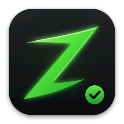

# ztodo



A [Todoist](https://todoist.com)-style to-do app for **Linux (amd64)** and
**macOS Apple Silicon**, built with C++20 and Qt 6 Widgets. Your tasks live in a
folder on **Box**, so every Mac and Linux machine you use sees the same list,
with no account or server besides Box.

**0.2.0** — Inbox, Today, Upcoming, projects, labels, priorities, subtasks,
recurring tasks, natural-language quick add, search, undo, due-time reminders, and
signed in-app updates. The version is shown in the window title (`ztodo 0.2.0 — Today`). Release history: [CHANGELOG.md](CHANGELOG.md).

Current release: **0.2.0**

## Features

- **Quick add** in plain words, Todoist style. Type and press Enter:
  `Call mom tomorrow 5pm p1 #Family @phone`,
  `Standup every weekday 9:30am #Work`, `Pay rent every 1st p2 @bills`.
  A preview under the box shows what was recognised before you press Enter.
  - Dates: `today`, `tomorrow`, `fri`, `next mon`, `next week`, `in 3 days`,
    `nov 20`, `12/24`, `2027-01-05`, `eom`
  - Times: `5pm`, `9:30am`, `at 17:00`, `noon`
  - Repeat: `every day`, `every weekday`, `every mon and thu`, `every 2 weeks`,
    `every 15th`, `monthly`. `every!` counts from when you complete the task
    instead of from its due date.
  - `p1` … `p4` priority, `#Project` (created if new; `_` for spaces), `@label`
- **Views:** Inbox, Today (overdue first), Upcoming (grouped by day), Completed,
  each project and label, and search (Ctrl+F) over titles and notes.
- **Tasks** have notes, a due date and optional time, a repeat rule, priority
  (coloured circle), project, labels and subtasks. Completing a recurring task
  moves it to its next date.
- **Keyboard:** Q or Ctrl+N quick add · Space complete · Enter edit ·
  Del delete · Alt+↑/↓ reorder · Ctrl+Z undo · Ctrl+1…4 views · F5 sync.
- **Undo** for everything: complete, delete, edit, move, projects.
- **Signed auto-update:** checks GitHub once a day (optional). On Linux it
  installs the new `.deb` with `pkexec apt`; on macOS it replaces `ztodo.app`
  in place. Nothing is installed unless the release's `SHA256SUMS` carries a
  valid minisign signature from the key built into the app.
- **Reminders:** a desktop notification when a task with a time is due (optionally
  5–60 minutes before; Preferences). All-day tasks are not reminded. Each device
  reminds for itself, and reminders missed while ztodo was closed are skipped
  (ztodo has to be running). It uses a system notification; if the desktop has
  no system tray, the reminder shows in the window's status bar instead.
- Light and dark themes follow the system.

## How syncing works

ztodo never talks to Box itself. It reads and writes a normal folder, and Box
syncs that folder:

| Platform | Box client | Default data folder |
|---|---|---|
| macOS | [Box Drive](https://www.box.com/drive) | `~/Library/CloudStorage/Box-Box/ztodo` |
| Linux | [rclone](https://rclone.org/box/) `bisync` (or `mount`) | `~/Box/ztodo` |

On first start ztodo finds your Box folder and suggests `…/ztodo` inside it.
Pick the same Box folder on every device.

**Conflict-free by design.** Each device appends its changes to its own file,
`devices/<device-id>.jsonl`, and never writes anyone else's. Every device reads
all of the files and merges them field by field (the latest change to each
field wins). So two machines editing while offline never produce a Box
conflict, and edits to different fields of the same task are both kept.
Details: [docs/STORAGE.md](docs/STORAGE.md).

### Linux: syncing ~/Box with rclone

Box has no Linux client, so use rclone:

```sh
rclone config                                  # add a remote named "box" (type: box)
mkdir -p ~/Box
rclone bisync box: ~/Box --resync              # first run only
```

Then run `rclone bisync box: ~/Box` on a timer, for example with a systemd user
timer (`~/.config/systemd/user/boxsync.service` + `boxsync.timer`). If ztodo
finds `boxsync.service`, it suggests this **sync command** in Preferences:

```
systemctl --user start --no-block boxsync.service
```

ztodo runs it at startup, on **File → Sync Now** (F5), and 5 seconds after each
change, so other devices get your changes in seconds rather than at the next
timer tick. Changes from other devices show up within 15 seconds of reaching
the folder.

On macOS, Box Drive syncs by itself: leave the sync command empty.

## Install

Download from the [latest release](https://github.com/sbj-ee/ztodo/releases/latest):

- **Linux (Debian/Ubuntu, amd64):** `sudo apt install ./ztodo_<version>_amd64.deb`
- **macOS (Apple Silicon, 14+):** open `ztodo-<version>-Darwin.dmg` and drag
  `ztodo.app` to Applications. The app is ad-hoc signed, so the first time,
  right-click it and choose **Open**.

To check a download by hand:

```sh
minisign -Vm SHA256SUMS -P RWQfb7N3uguWMhJ7jsE/Z0hZ7pDWHQ9OEeWSBTlN/R5bxQ8HWSMxp/l9
sha256sum -c SHA256SUMS --ignore-missing
```

After that, **Help → Check for Updates** (or the daily check) keeps it current.

## Build

Linux (Ubuntu 24.04):

```sh
sudo apt install qt6-base-dev cmake ninja-build g++ libsodium-dev pkg-config
cmake -B build -G Ninja -DCMAKE_BUILD_TYPE=Release
cmake --build build
ctest --test-dir build --output-on-failure
./build/app/ztodo
cd build && cpack -G DEB           # ztodo_<version>_amd64.deb
```

macOS (Apple Silicon):

```sh
brew install qt cmake ninja libsodium pkg-config
cmake -B build -G Ninja -DCMAKE_BUILD_TYPE=Release -DCMAKE_PREFIX_PATH="$(brew --prefix qt)"
cmake --build build
open build/app/ztodo.app
cd build && cpack -G DragNDrop     # ztodo-<version>-Darwin.dmg
```

## Files

| What | Where |
|---|---|
| Tasks (shared) | `<data folder>/devices/*.jsonl`, `<data folder>/ztodo.json` |
| Settings (this device) | `~/.config/ztodo/ztodo.ini` (macOS: `~/Library/Preferences/ztodo/ztodo.ini`) |
| Device id | `~/.config/ztodo/device-id`. Don't copy it to another machine. |
| Update state | `~/.config/ztodo/update-state.ini` |

## Releasing

Bump `project(ztodo VERSION …)` in `CMakeLists.txt`, add a `CHANGELOG.md`
entry, then tag `vX.Y.Z`. See [docs/RELEASING.md](docs/RELEASING.md).

## License

MIT. See [LICENSE](LICENSE).
